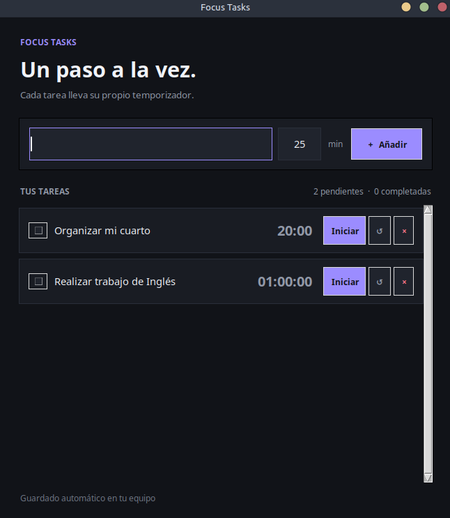

# Focus Tasks

Aplicación de escritorio de código abierto para Windows y Linux. Permite organizar tareas con temporizadores independientes, marcar tareas completadas y recibir un aviso al terminar el tiempo.

## Captura de pantalla



## Descargar

Ve a la sección **Releases** de este repositorio y descarga el archivo para tu sistema:

- **Debian o Ubuntu:** `focustask_<versión>_all.deb`
- **Windows:** `FocusTasks.exe`

En Debian o Ubuntu, instala el `.deb` haciendo doble clic o con:

```bash
sudo apt install ./focustask_1.0.0_all.deb
```

En Windows, abre `FocusTasks.exe`. No necesitas instalar Python.

## Ejecutar desde el código fuente

Necesitas Python 3 y Tkinter. En Debian o Ubuntu, instala Tkinter si hace falta:

```bash
sudo apt install python3-tk
```

En Linux, ejecuta `./FocusTasks.sh`. En Windows, abre PowerShell en la carpeta del proyecto y ejecuta:

```powershell
py focus_tasks.py
```

## Crear instaladores

El mismo archivo `focus_tasks.py` contiene la app para ambos sistemas. Los scripts de `packaging/` generan el `.deb` de Debian/Ubuntu y el `.exe` de Windows.

Para generar los dos instaladores y publicarlos, usa **Actions → Build and release → Run workflow** en GitHub. Deja la versión `1.0.0` para mantener la versión actual. Al completar el flujo, los archivos aparecen en **Releases**.

## Datos y privacidad

Las tareas se guardan en el equipo del usuario:

- Linux: `$XDG_DATA_HOME/focus-tasks/tasks.json` o, si no se define `XDG_DATA_HOME`, `~/.local/share/focus-tasks/tasks.json`.
- Windows: `%LOCALAPPDATA%\focus-tasks\tasks.json`.

La app no sube tus tareas a GitHub ni a ningún servidor. El repositorio excluye `data/tasks.json`, que podría contener tareas personales.

## Licencia

Este proyecto se distribuye bajo la licencia MIT. Consulta [LICENSE](LICENSE).
